<div align="center">

# AgencyOrder

### El sistema de gestión y reportes que convierte el caos de una agencia en operación profesional.

<!-- ============================ BANNER PRINCIPAL ============================ -->
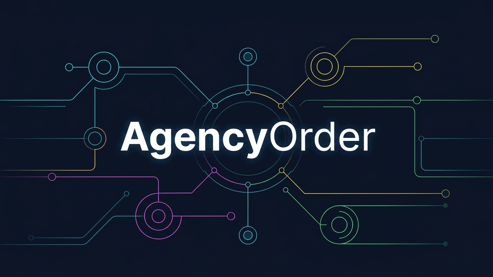

<br>

<!-- ============================ BADGES / INSIGNIAS ============================ -->


</div>

---

## Navegación Rápida

> Salta directo a la sección que necesitas con un clic.

<table>
<tr>
<td valign="top" width="50%">

**El Producto**
- [¿Qué es AgencyOrder?](#qué-es-agencyorder)
- [El problema que resuelve](#el-problema-que-resuelve)
- [¿Por qué vale la pena?](#por-qué-vale-la-pena)

**Roles del sistema**
- [Jerarquía de usuarios](#jerarquía-de-usuarios)
- [Flujo de acceso](#flujo-de-acceso)

**Primer arranque**
- [Instalación y ejecución](#instalación-y-ejecución)
- [Primer inicio del Dueño](#primer-inicio-del-dueño)

</td>
<td valign="top" width="50%">

**Recorrido visual (con capturas)**
- [Panel del Dueño](#panel-del-dueño)
- [Negocios afiliados](#negocios-afiliados)
- [Reportes y PDF real](#reportes-y-pdf-real)
- [Checklist de tareas](#checklist-de-tareas)
- [Equipo / Empleados](#equipo--empleados)
- [Finanzas (P&L)](#finanzas-pl)
- [Marca y PDFs](#marca-y-pdfs)
- [Integraciones de envío](#integraciones-de-envío)
- [Portal del Cliente](#portal-del-cliente)

**Anexos**
- [Galería completa de capturas](docs/screenshots/)
- [Stack técnico](#stack-tecnológico)
- [Licencia y créditos](#licencia-y-créditos)

</td>
</tr>
</table>

---

## ¿Qué es AgencyOrder?

**AgencyOrder** es un sistema web completo para **agencias de marketing y servicios** que gestionan varios negocios afiliados. Centraliza en un solo lugar **clientes, equipo, tareas, reportes profesionales en PDF, finanzas y comunicación con el cliente**, con un **portal privado** para que cada negocio vea sus resultados.

Está construido en **FastAPI** con base de datos **SQLite asíncrona**, y entrega a la agencia una imagen profesional de extremo a extremo: desde el login del dueño hasta el reporte con marca blanca que recibe el cliente final.

> 📦 **Modelo de producto:** software de **licencia única** (no es un servicio SaaS multi-tenant). La agencia lo monta en su propio servidor en la nube o en su red, y todos sus usuarios acceden por internet.

---

## El problema que resuelve

Las agencias pequeñas y medianas suelen operar así:

> *Clientes en hojas de cálculo… tareas en chats de WhatsApp… reportes hechos a mano en Word o Canva… y "te paso los números por mensaje".*

Ese caos genera **desorden, pérdida de información y una percepción poco profesional** frente al cliente. AgencyOrder elimina ese caos con un flujo claro:

- **Una sola fuente de verdad** para clientes, equipo y tareas.
- **Reportes profesionales generados automáticamente** con la marca de la agencia.
- **Transparencia para el cliente final** mediante su propio portal.

---

## ¿Por qué vale la pena?

| El dolor de la agencia | Cómo lo resuelve AgencyOrder |
|---|---|
| Datos y acuerdos dispersos | Ficha centralizada por cliente (contacto, cuota, gestor, notas). |
| "No sé en qué quedamos con cada cliente" | **Checklist de tareas** semanales por cliente. |
| Reportes a mano en Word/Canva | **PDF real** generado con la marca de la agencia, métricas y resumen. |
| No le demuestro valor al cliente | El cliente entra a **su portal** y ve sus reportes cuando quiera. |
| Gestión de equipo difusa | Empleados ven **solo sus clientes asignados**; el dueño supervisa todo. |
| No sé si gano o pierdo | **Finanzas / P&L** con balance y margen automáticos. |
| Imagen poco profesional | **Marca blanca**: logo, colores y plantillas en todos los documentos. |

**Lo que gana el cliente de la agencia:** un portal privado con usuario y código, reportes claros (inversión, leads, costo por lead, estado de campaña) y una experiencia que hace ver a la agencia como un socio serio.

---

## Jerarquía de usuarios

Una relación estricta de arriba hacia abajo: **el Dueño es la raíz**. Empleados y clientes **no existen por sí solos**; los crea el Dueño.

```text
👑 DUEÑO (Admin / Root)
│   ├── 👤 EMPLEADOS  → solo ven/gestionan SUS clientes asignados
│   └── 🏢 CLIENTES   → solo ven SUS reportes en su portal privado
```

---

## Flujo de acceso

| Usuario | URL | Credenciales | Pantalla inicial |
|---|---|---|---|
| 👑 Dueño (primer arranque) | `/auth/admin/login` | `admin` + clave autogenerada | Cambio forzoso de credenciales |
| 👑 Dueño (ya configurado) | `/auth/admin/login` | Usuario y clave propios | Dashboard |
| 👤 Empleado | `/auth/login` | Correo + contraseña | Dashboard (solo sus clientes) |
| 🏢 Cliente | `/portal/login` | Usuario + código `CLI-XXXXXX` | Portal de reportes |

---

## Instalación y ejecución

```bash
cd agency_system

# 1. Entorno virtual
python -m venv venv
source venv/bin/activate        # Windows: venv\Scripts\activate

# 2. Dependencias
pip install -r requirements.txt

# 3. (Opcional) Datos de demostración
python seed.py

# 4. Servidor
uvicorn main:app --reload --host 0.0.0.0 --port 8000
```

Abre **`http://localhost:8000`**.

> ⚠️ **WeasyPrint en Linux** (para el PDF real) requiere: `sudo apt install libpango-1.0-0 libpangoft2-1.0-0 libcairo2 libgdk-pixbuf-2.0-0`. En Windows/Mac se instala solo. Si falta, el reporte se genera igual en HTML imprimible (sin romper el flujo).

---

## Primer inicio del Dueño

La **primera vez** que arranca el sistema con la base de datos vacía, se crea la cuenta del Dueño y se **genera una clave temporal** que aparece en **dos sitios**:

1. **La terminal** (bloque `[PRIMER INICIO]`).
2. El archivo **`instance/CLAVE_INICIAL_ADMIN.txt`**.

<p align="center">
  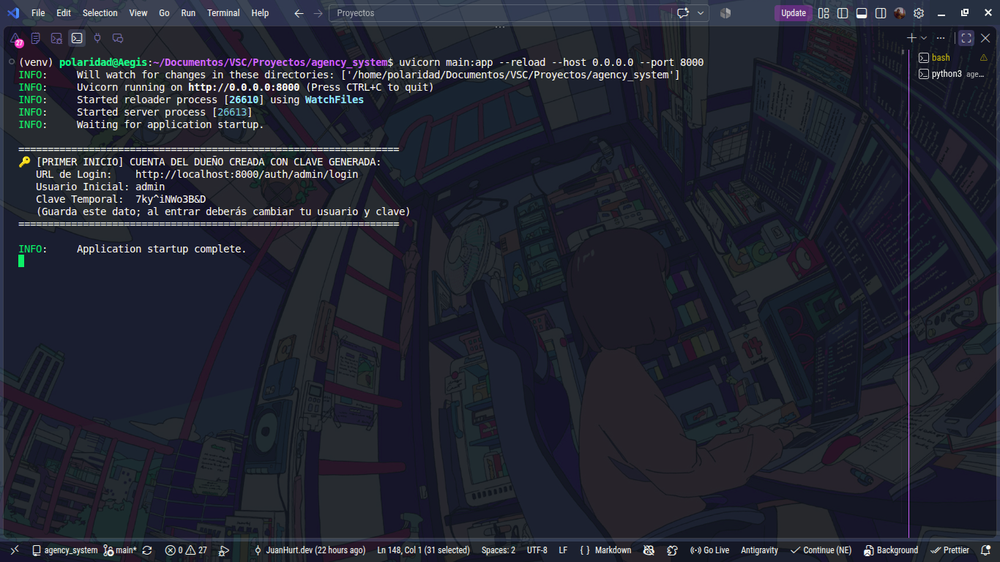
  <br><em>1. Primer arranque: la consola muestra el usuario `admin` y su clave temporal generada.</em>
</p>

Con ese usuario y clave, el dueño entra en `/auth/admin/login`:

<p align="center">
  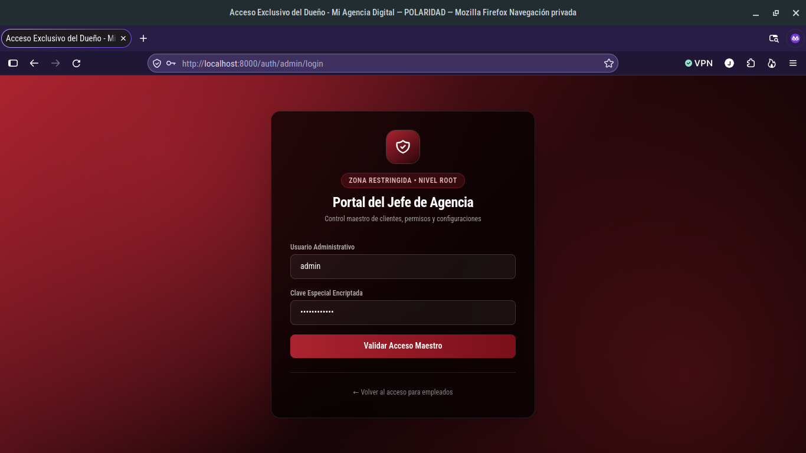
  <br><em>2. Login exclusivo del Dueño de la agencia.</em>
</p>

Apenas ingresa, el sistema lo **obliga a cambiar** el usuario y definir una contraseña segura (mínimo 10 caracteres, mayúsculas, minúsculas, números y símbolos). Así ningún sistema queda con la clave temporal expuesta.

<p align="center">
  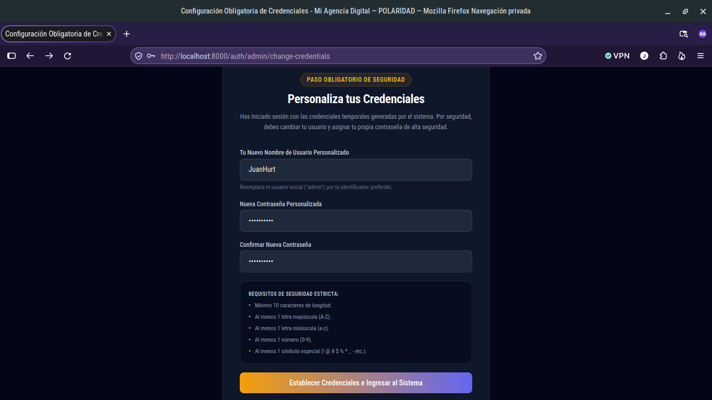
  <br><em>3. Configuración obligatoria de credenciales definitivas del Dueño.</em>
</p>

> 🔒 **Seguridad:** contraseñas con **bcrypt (12 rondas)**, sesiones **JWT en cookies HTTP-Only** y un middleware que bloquea todo acceso hasta completar el cambio de credenciales.

---

## Panel del Dueño

El centro de control de la agencia. Muestra de un vistazo **clientes activos vs. pausados, ingresos recurrentes (MRR), reportes enviados por mes**, gráficos con **Chart.js** y un **diagnóstico automático** de la salud del negocio.

<p align="center">
  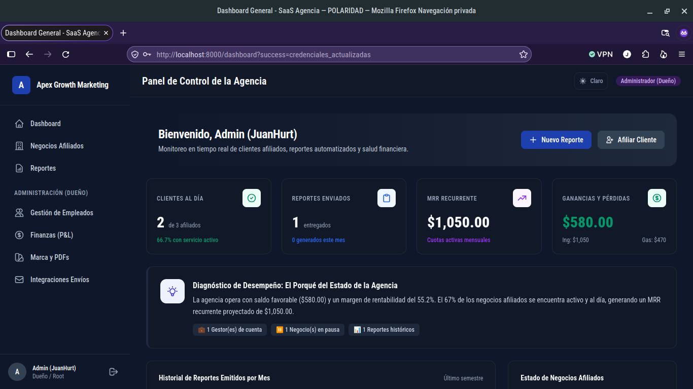
  <br><em>Vista 1 — Resumen ejecutivo: métricas de la agencia, MRR y estado de la cartera.</em>
</p>

Y, al continuar en la misma pantalla, el dueño encuentra la **zona de gráficas interactivas y la actividad reciente** del negocio:

<p align="center">
  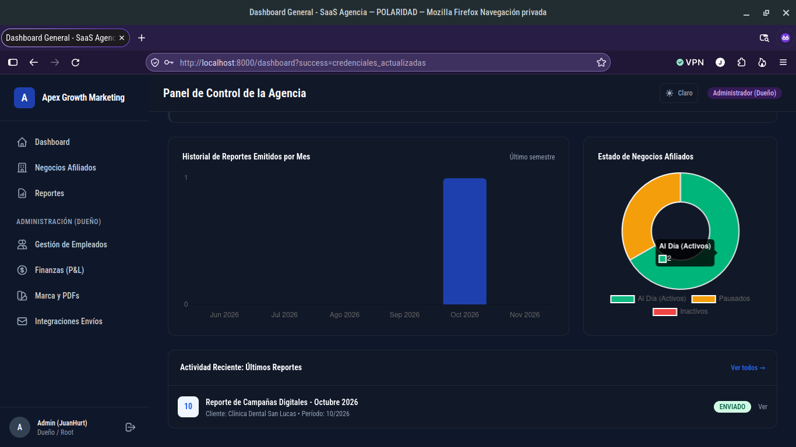
  <br><em>Vista 2 — Gráficas (reportes por mes, estatus de clientes) y actividad reciente de la agencia.</em>
</p>

---

## Negocios afiliados

Cada cliente es una ficha completa: **contacto, correo, teléfono, cuota mensual, gestor asignado, notas**, estado (Activo / Pausado / Inactivo) y el **acceso directo al portal**. Desde aquí el dueño **genera reportes, edita, pausa o reanuda** y envía/regenera las credenciales del cliente.

<p align="center">
  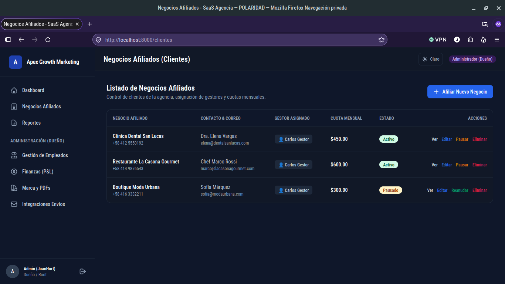
  <br><em>Listado de clientes con acciones rápidas por negocio.</em>
</p>

<p align="center">
  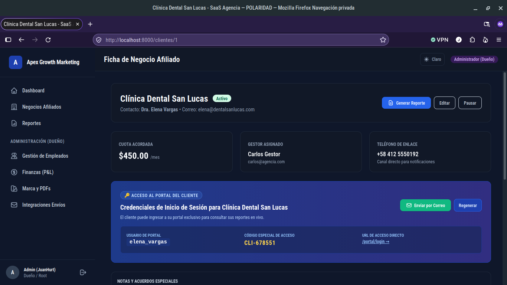
  <br><em>Ficha del cliente: generar reporte, editar, pausar, cuota acordada, email, teléfono y acceso al portal del cliente.</em>
</p>

---

## Reportes y PDF real

El corazón del valor que entrega la agencia. Cada reporte captura **datos estructurados y medibles**:

- 💵 **Inversión** del período.
- 🎯 **Leads / Resultados** obtenidos.
- 📈 **Costo por lead** (calculado automáticamente).
- 🚦 **Estado de la campaña** (Activa / En Optimización / Pausada / Finalizada).

<p align="center">
  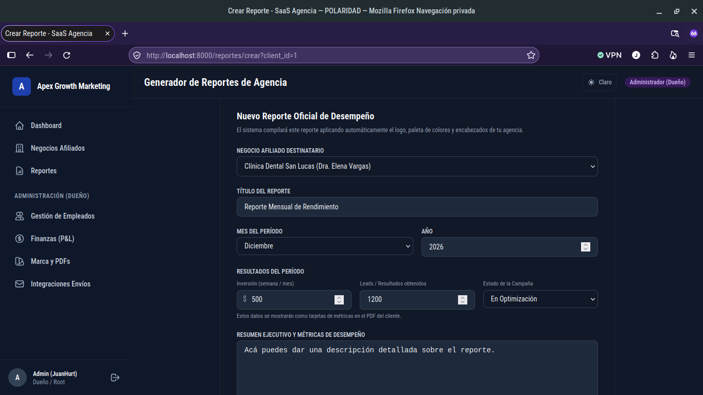
  <br><em>Historial de reportes por cliente y período.</em>
</p>

Al abrir un reporte, el sistema muestra las **métricas en tarjetas**, la **vista previa del PDF** ya compuesto con la marca de la agencia, y botones para **descargar/imprimir** o **enviar al cliente**.

<p align="center">
  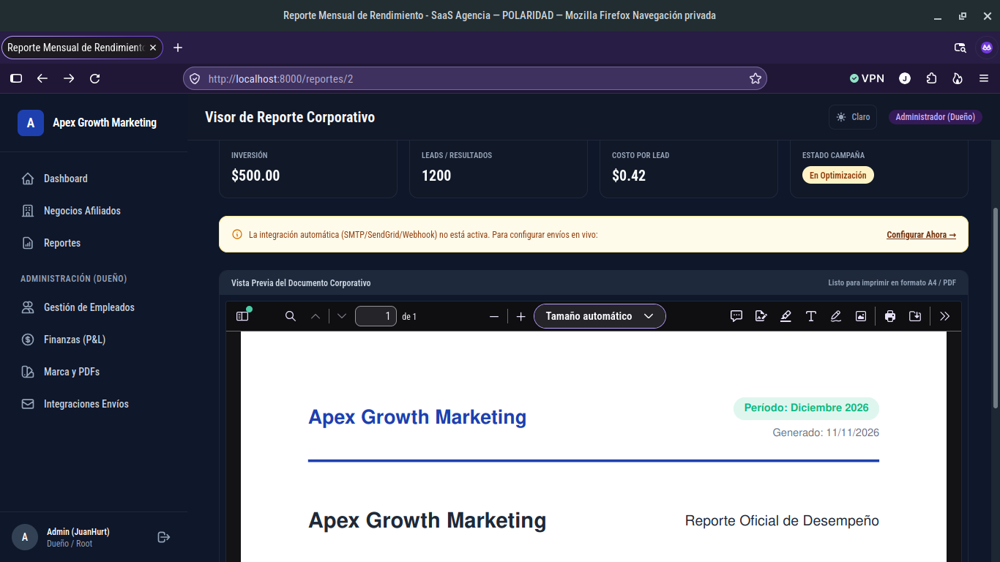
  <br><em>Detalle del reporte: inversión, leads, costo por lead, estado de campaña y vista previa del PDF.</em>
</p>

> 📄 El PDF se genera **en el backend con WeasyPrint** (HTML → PDF A4 de calidad), incluyendo logo, colores, encabezado y pie de página personalizados por la agencia.

---

## Checklist de tareas

Resuelve el "caos operativo": en la ficha de cada cliente hay un **checklist rápido** para añadir, marcar y eliminar tareas semanales ("Diseñar creativos", "Revisar pauta", "Enviar reporte"…), con contador de **completadas / totales**. La agencia deja de perder tareas en los chats.

<p align="center">
  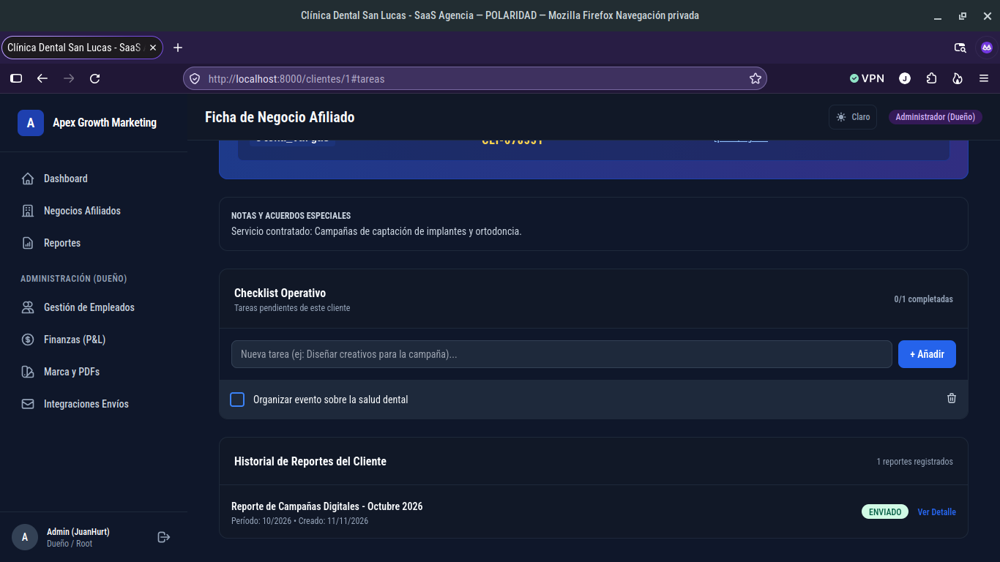
  <br><em>Checklist operativo por cliente con tareas pendientes y completadas.</em>
</p>

---

## Equipo / Empleados

El Dueño crea y administra a los gestores de cuenta. Cada empleado recibe su acceso y **solo puede ver y gestionar los clientes que se le asignan**.

<p align="center">
  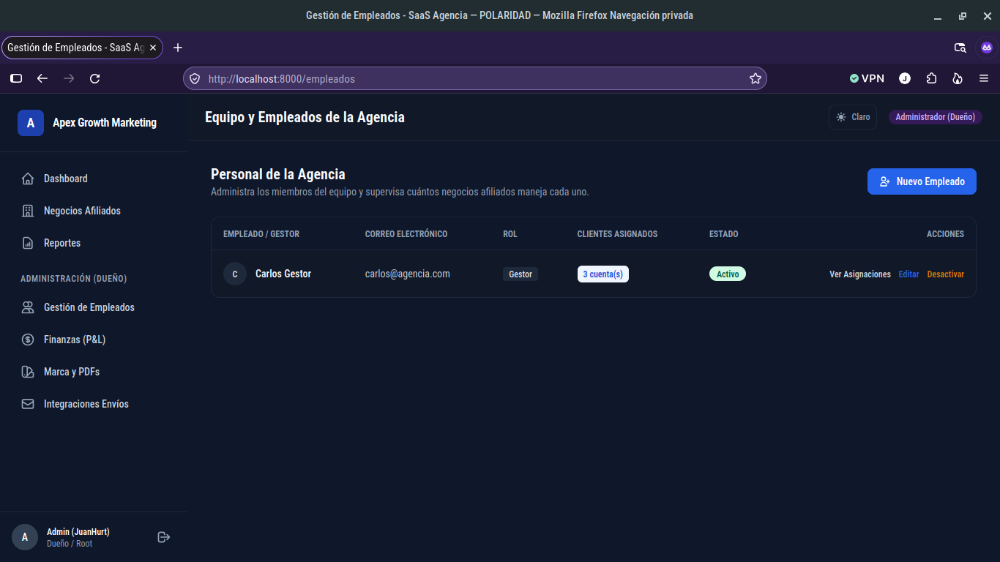
  <br><em>Listado del equipo con estado y clientes asignados.</em>
</p>

<p align="center">
  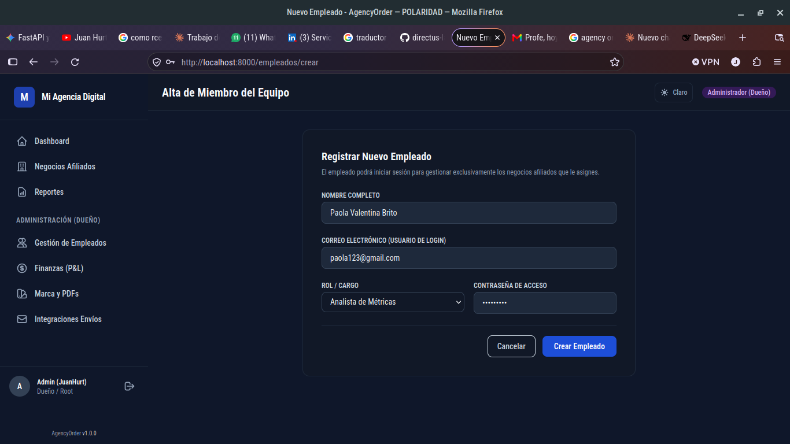
  <br><em>Formulario de creación de un nuevo empleado/gestor.</em>
</p>

Al iniciar sesión, el empleado ve su **propio dashboard**, limitado a su cartera:

<p align="center">
  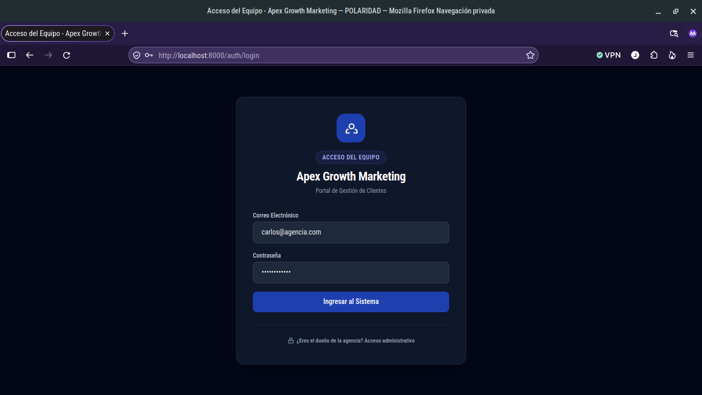
  <br><em>Acceso del equipo de la agencia.</em>
</p>

<p align="center">
  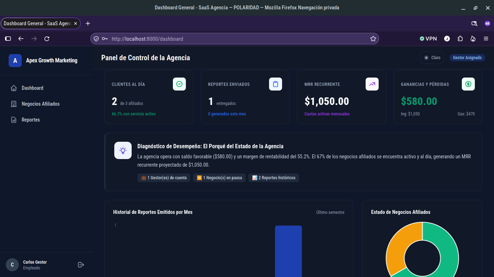
  <br><em>Inicio del empleado con sus clientes asignados.</em>
</p>

---

## Finanzas (P&L)

Control de **cobros a clientes** y **gastos operativos** (servidores, nómina, software, pauta), con cálculo automático de **balance neto y margen de beneficio**. La agencia sabe, en tiempo real, si gana o pierde.

<p align="center">
  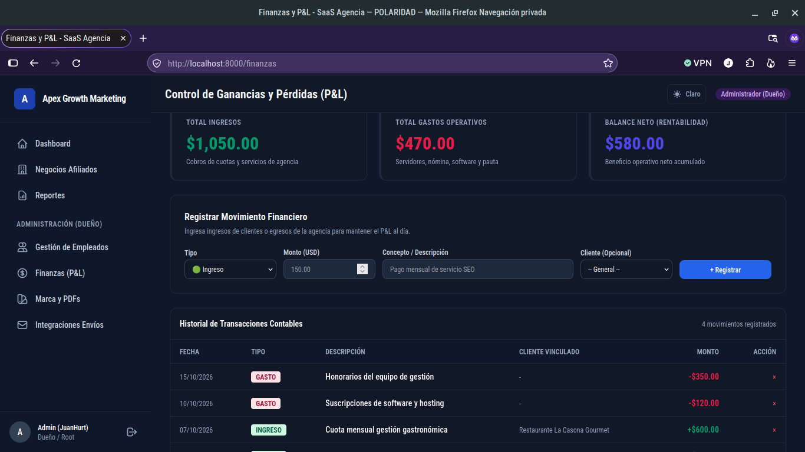
  <br><em>Balance de ingresos vs. gastos y margen de beneficio.</em>
</p>

---

## Marca y PDFs

Personalización **marca blanca** sin tocar código: subida del **logo**, selector de **colores corporativos** (primario, secundario, acento), color del **login del dueño**, **dominio propio del portal** y edición de **encabezado/pie de página HTML** de los reportes.

<p align="center">
  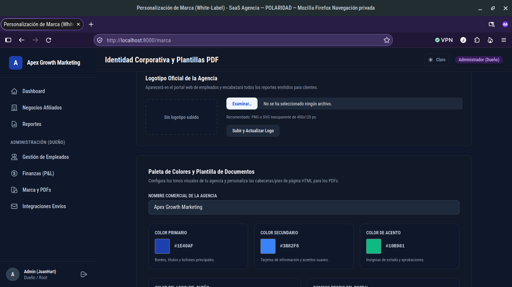
  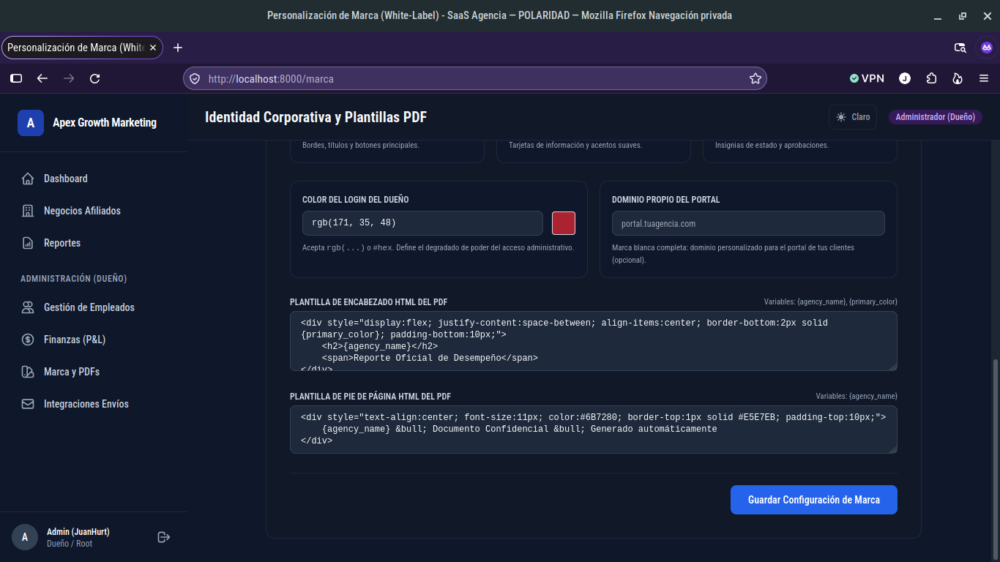
  <br><em>Configuración de identidad visual y plantillas de los documentos.</em>
</p>

> 📌 La marca de la agencia es **totalmente configurable** y es independiente del nombre del producto (AgencyOrder) y de sus créditos.

---

## Integraciones de envío

Automatiza la comunicación con el cliente. Configura el canal de envío una vez y despacha **reportes** y **credenciales del portal** con un clic:

- **SMTP** (Gmail, Outlook, Amazon SES, Zoho…).
- **SendGrid** (API v3).
- **Webhooks** salientes (Zapier / Make / n8n).

Las claves y contraseñas se guardan **cifradas con Fernet (AES)**.

<p align="center">
  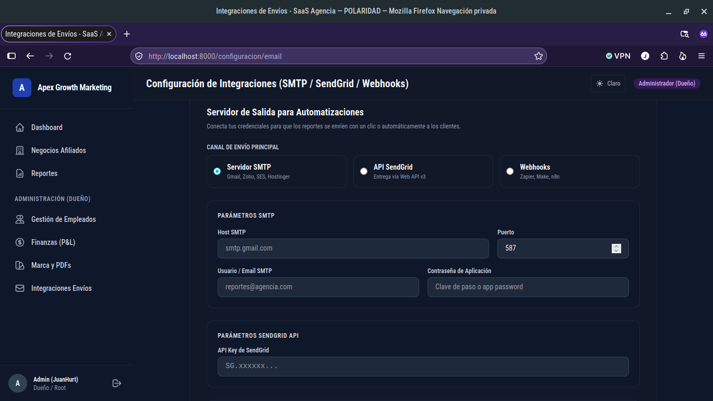
  <br><em>Panel de integraciones de envío (SMTP / SendGrid / Webhook).</em>
</p>

---

## Portal del Cliente

La pieza que hace que el cliente **ame** el servicio: un portal privado y aislado donde cada negocio consulta sus reportes y métricas, con la marca de la agencia.

<p align="center">
  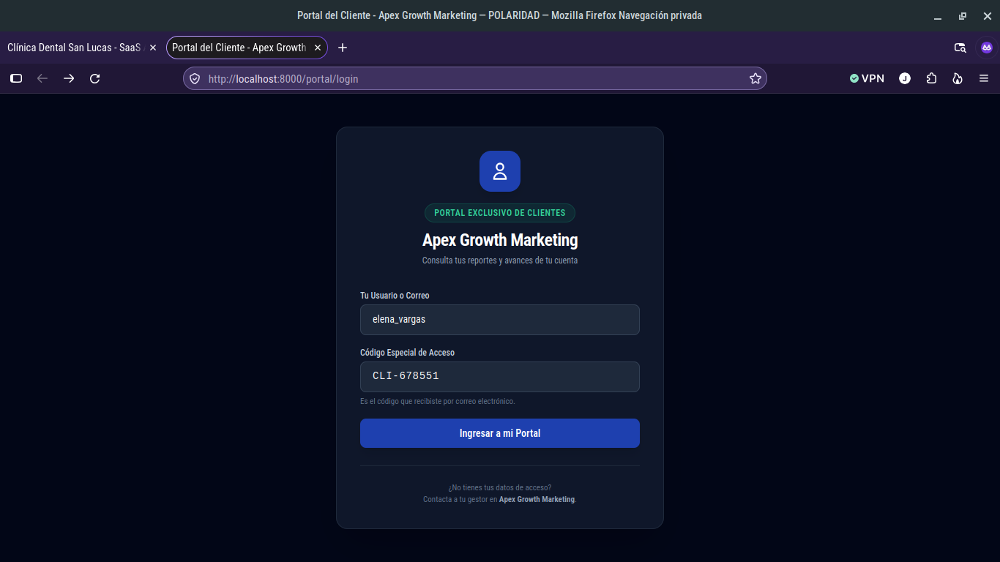
  <br><em>Acceso del cliente con su usuario y código especial (`CLI-XXXXXX`).</em>
</p>

<p align="center">
  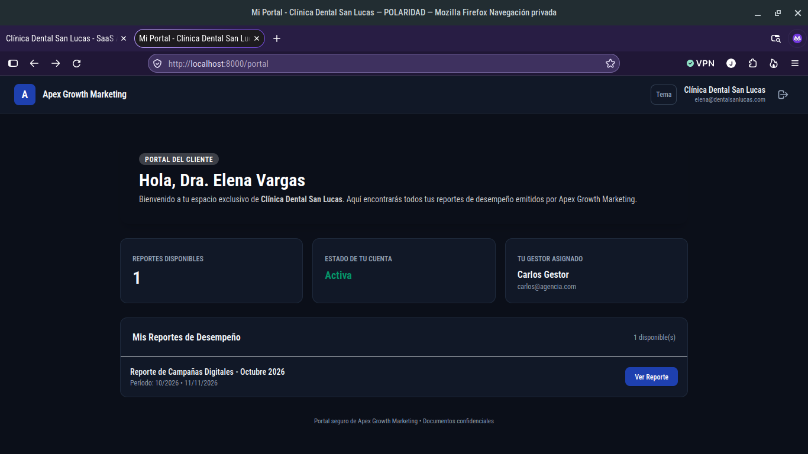
  <br><em>Portal del cliente: sus reportes, su estado de cuenta y su gestor asignado.</em>
</p>

> 🔒 **Aislamiento total:** el cliente solo accede a sus propios reportes. Los negocios pausados o inactivos no pueden entrar (servicio suspendido).

---

## Galería completa de capturas

Todas las imágenes del recorrido están disponibles en la carpeta:

### **[`docs/screenshots/`](docs/screenshots/)**

Ahí encontrarás las capturas de cada pantalla del sistema lista para explorar.

---

## Stack tecnológico

| Capa | Tecnología | Propósito |
|---|---|---|
| **Backend** | FastAPI (Python 3.12) | Asíncrono, validación con Pydantic v2 |
| **ORM** | SQLAlchemy 2.0 (Async) + greenlet | Acceso a datos seguro |
| **Base de datos** | SQLite vía `aiosqlite` | Ligera para agencias pequeñas/medianas |
| **PDF** | WeasyPrint | Genera PDF real desde HTML con branding |
| **Frontend** | Jinja2 + TailwindCSS (CDN) + Chart.js | UI moderna, responsiva y con modo claro/oscuro |
| **Seguridad** | bcrypt + python-jose (JWT) + Fernet | Hashes, sesiones y cifrado de claves API |
| **Sesión** | JWT en cookie HTTP-Only | Protección XSS/CSRF |

---

## Estructura del proyecto

```text
agency_system/
├── config.py             # Configuración + metadatos del producto
├── database.py           # Conexión async + migraciones automáticas
├── main.py               # App FastAPI, lifespan, primer arranque
├── seed.py               # Datos demo
├── models/               # Admin, Employee, Client, Report, Task, BrandConfig, EmailConfig, FinancialRecord
├── routes/               # auth, portal, clients (+tareas), dashboard, employees, reports, brand, financial, settings, deps
├── services/             # auth_service, email_service, pdf_service (WeasyPrint)
├── templates/            # Jinja2 + TailwindCSS
├── static/uploads/       # logos y reportes (HTML + PDF)
├── docs/screenshots/     # Capturas del sistema
└── instance/             # agency.db + CLAVE_INICIAL_ADMIN.txt (no versionados)
```

---

## Notas de seguridad

- **Contraseñas:** hash **bcrypt** irreversible (12 rondas), nunca en texto plano.
- **Claves API** (SMTP/SendGrid): cifradas con **Fernet** derivado de `SECRET_KEY`.
- **Sesiones:** JWT firmado en cookie **HTTP-Only**; panel y portal usan **cookies separadas** para no interferir entre sí.
- **Aislamiento por rol:** el middleware de dependencias bloquea accesos cruzados entre clientes, empleados y dueño.
- **Primer arranque:** clave temporal + cambio forzoso de credenciales.
- **Producción:** cambia `SECRET_KEY`, usa **HTTPS** y considera **PostgreSQL** para mayor escala.

---

## Licencia y créditos

> **AgencyOrder** — v1.0.0
>
> **Desarrollado por Juan José Hurtado Hurtado** · ☎️ +58 04141884628
>
> © 2026 Juan José Hurtado Hurtado. Todos los derechos reservados.

Este es un **producto de software propietario**. Su código, documentación e identidad son de autoría de **Juan José Hurtado Hurtado**. El nombre **AgencyOrder** identifica al producto y es independiente de la **marca de la agencia**, que es configurable libremente desde *Marca y PDFs*.

<div align="center">

**Hecho con ❤️ para agencias que quieren verse y operar como profesionales.**

⬆️ [Volver arriba](#agencyorder)

</div>
